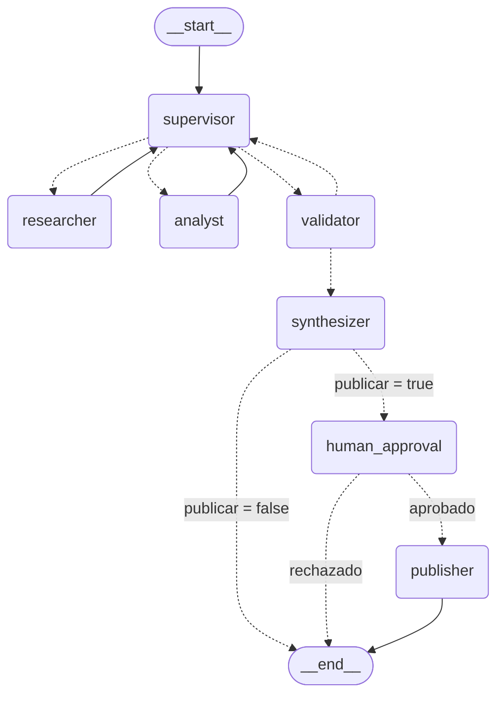

# API de producción para el orquestador multi-agente

Pre-Entrega 7 (Módulo 7, AI Engineering). Expone el [orquestador multi-agente del Módulo 6](https://github.com/JhovanEspinal/orquestador-multiagente) como una API REST asíncrona:

- **FastAPI** recibe la tarea, la registra y la encola en **Redis**, y devuelve un `job_id` al instante.
- Un **worker** ejecuta el grafo y guarda el estado del trabajo y los **checkpoints de LangGraph** en Redis.
- **LangSmith** recibe una traza de cada ejecución, con cada nodo, cada llamada al LLM, sus tokens y su costo.
- Si la tarea pide **publicar** el informe, el grafo se **detiene** hasta que una persona lo apruebe.

```mermaid
flowchart LR
    client([Cliente]) -->|POST /tasks| api[FastAPI]
    api -->|1. job:id = PENDING| redis[(Redis)]
    api -->|2. LPUSH queue:tasks| redis
    api -->|202 + job_id| client
    worker[Worker] -->|BRPOP queue:tasks| redis
    worker -->|ainvoke + checkpoints| graph[Grafo LangGraph]
    graph -->|AsyncRedisSaver| redis
    worker -->|RUNNING / WAITING_APPROVAL / DONE / FAILED| redis
    graph -.->|trazas| langsmith[(LangSmith)]
    client -->|GET /tasks/id polling| api
    client -->|POST /tasks/id/approve| api
```

## Grafo

Es el orquestador del M6, al que se agregan la aprobación humana y la publicación:



## Estructura

| Archivo | Rol |
|---|---|
| `app/main.py` | Endpoints FastAPI y arranque del runtime y del worker (`lifespan`) |
| `app/graph.py` | Orquestador del M6 con checkpointer de Redis, aprobación humana y nodo `publisher` |
| `app/worker.py` | Consume la cola, ejecuta el grafo, actualiza el estado y marca `FAILED` ante excepciones. También corre como proceso aparte |
| `app/observability.py` | Configuración de LangSmith y metadatos de cada ejecución |
| `app/hitl.py` | Nodo `human_approval` con `interrupt()`, criterio de criticidad y reanudación |
| `app/jobs.py` | Estado de los trabajos, cola e informes publicados en Redis |
| `app/runtime.py` | Conexión a Redis, `AsyncRedisSaver` y construcción del grafo |
| `app/schemas.py` | Contratos Pydantic de la API y estados del trabajo |
| `app/orchestrator/` | Código del M6: supervisor, especialistas, validador, herramientas y datos |
| `scripts/load_test.py` | Prueba de 5 peticiones concurrentes |
| `docker-compose.yml` / `Dockerfile` | Redis y la API |
| `screenshots/` | Capturas del dashboard. **Pendientes**: ver [screenshots/README.md](screenshots/README.md) |
| `tests/` | Pruebas con Redis en memoria y un modelo guionizado |

## Endpoints

| Método y ruta | Qué hace | Respuesta |
|---|---|---|
| `POST /tasks` | Registra el trabajo en Redis como `PENDING`, lo encola y responde sin esperar al grafo | `202` con `job_id` |
| `GET /tasks/{job_id}` | Estado, delegación, respuesta y aprobación pendiente | `200`, o `404` si no existe |
| `POST /tasks/{job_id}/approve` | Registra la decisión humana y encola la reanudación | `202`, o `409` si no espera aprobación o ya se decidió |
| `GET /reports/{job_id}` | Informe publicado tras la aprobación | `200`, o `404` |
| `GET /health` | Comprueba la conexión con Redis | `200`, o `503` |

La documentación interactiva queda en `http://localhost:8000/docs`.

### Estados de un trabajo

```
PENDING → RUNNING → DONE
                  → FAILED             (cualquier excepción del grafo)
                  → WAITING_APPROVAL → (POST /approve) → PENDING → RUNNING → DONE
```

## Cómo levantar Redis y la API

Requiere Python 3.12, Docker para Redis, una clave de LLM y una clave gratuita de LangSmith.

Redis debe ser **8.0 o superior**, o Redis Stack: `langgraph-checkpoint-redis` necesita los módulos RedisJSON y RediSearch, que vienen incluidos desde Redis 8.

```bash
copy .env.example .env      # completa ANTHROPIC_API_KEY (u OPENAI_API_KEY) y LANGSMITH_API_KEY
```

**Opción A: todo con Docker Compose (recomendada)**

```bash
docker compose up --build
```

Levanta Redis y la API en `http://localhost:8000`. El worker corre dentro de la API, con 5 tareas en paralelo.

**Opción B: Redis en Docker y la API local**

```bash
docker run -d --name redis-agentes -p 6379:6379 redis:8.2
python -m venv .venv
.venv\Scripts\activate
pip install -r requirements.txt
uvicorn app.main:app --port 8000
```

Para correr el worker como **proceso aparte**, define `RUN_WORKER_IN_API=false` en `.env` y en otra terminal ejecuta:

```bash
python -m app.worker
```

## Probar el flujo

```bash
curl -X POST http://localhost:8000/tasks -H "Content-Type: application/json" -d "{\"solicitud\": \"Compara los audífonos AuraSound X2 y Nimbus Pro\"}"
curl http://localhost:8000/tasks/<job_id>
```

**Aprobación humana:** envía la misma solicitud con `"publicar": true`. Cuando el estado llegue a `WAITING_APPROVAL`, aprueba o rechaza:

```bash
curl -X POST http://localhost:8000/tasks/<job_id>/approve -H "Content-Type: application/json" -d "{\"aprobado\": true, \"revisor\": \"jhovan\", \"comentario\": \"Revisado\"}"
curl http://localhost:8000/reports/<job_id>
```

## Prueba de 5 peticiones concurrentes

Con la API levantada:

```bash
python scripts/load_test.py
```

El script envía 5 solicitudes a la vez, consulta su estado hasta que terminan e imprime la duración de cada una y el p95 medido por el cliente. Después, en LangSmith:

1. Abre el proyecto `api-agentes-produccion` y filtra las trazas `job_orquestador` de la corrida.
2. Captura la lista de trazas, una traza abierta, el **costo por ejecución** y la **latencia p95**.
3. Revisa qué nodo concentra la latencia y cuál consume más tokens.
4. Guarda las capturas en `screenshots/` con los nombres de [screenshots/README.md](screenshots/README.md).

LangSmith calcula el costo a partir de los tokens de entrada y salida, con su tabla de precios por modelo. Con Ollama el costo aparece en cero, porque no tiene precio.

## Cómo cumple el entregable

| Requisito | Dónde |
|---|---|
| Endpoint asíncrono que encola y devuelve `job_id` sin bloquear | `create_task()` en `app/main.py` |
| Estado del trabajo persistido en Redis antes de encolarlo | `JobStore.create()` en `app/jobs.py` |
| Paso a `FAILED` ante una excepción en segundo plano | `Worker.process()` en `app/worker.py` |
| Checkpoints de LangGraph en Redis | `AsyncRedisSaver` en `app/runtime.py` |
| Patrón worker | `app/worker.py`, dentro de la API o como proceso aparte |
| Observabilidad con trazas de cada nodo | LangSmith: `app/observability.py` y `@traceable` en `execute()` |
| Pausa obligatoria para aprobación humana en tareas críticas | `human_approval` con `interrupt()` en `app/hitl.py` |
| Endpoint de aprobación externa | `POST /tasks/{job_id}/approve` |
| 5 peticiones concurrentes | `scripts/load_test.py` |
| Capturas de trazas, costo y p95 en `/screenshots` | **Pendientes**: requieren una ejecución real |
| `requirements.txt`, `.env.example`, Docker Compose y README | En la raíz del repositorio |

## Decisiones de diseño

- **Qué es crítico:** publicar el informe, porque tiene efectos fuera del sistema. Las tareas sin `"publicar": true` nunca se detienen. El sistema solo pide aprobación cuando llega al punto de publicar, no antes.
- **Interrupción en un nodo propio:** `human_approval` llama a `interrupt()` con lo que hay que aprobar. El checkpoint queda en Redis, así que la aprobación puede llegar horas después o a otro proceso. Al reanudar, LangGraph vuelve a ejecutar el nodo desde el principio, por eso el código anterior a `interrupt()` no tiene efectos.
- **Una sola decisión por trabajo:** un candado `SET NX` en Redis evita que dos aprobaciones simultáneas reanuden el grafo dos veces.
- **Tipos permitidos en los checkpoints:** el serializador de `langgraph-checkpoint-redis` guarda los informes Pydantic como sobres JSON y, por seguridad, se niega a reconstruir clases que no estén en una lista permitida. Sin esa lista, al reanudar un trabajo los informes volverían como diccionarios. `state_serializer()` en `app/runtime.py` registra solo las clases del estado.
- **`job_id` = `thread_id`:** cada trabajo es un hilo del checkpointer, de modo que su estado completo se puede consultar o reanudar por ese ID.
- **Sin bloqueos en el event loop:** los endpoints solo hacen operaciones asíncronas en Redis (`redis.asyncio`). El grafo corre en el worker, con LLM, SQLite (`aiosqlite`) y checkpoints asíncronos.
- **Estado antes que cola:** el trabajo se guarda como `PENDING` antes de encolarlo, para que un `GET` inmediato nunca devuelva `404`.
- **Excepciones en segundo plano:** cualquier excepción del grafo se registra y el trabajo pasa a `FAILED` con su causa. El worker sigue atendiendo la cola.
- **Trazas filtrables:** cada ejecución lleva `job_id` en los metadatos y una etiqueta con la versión de los prompts (`prompt:m6-v1`), para relacionar un cambio de prompt con un cambio de comportamiento.
- **Concurrencia:** el worker atiende 5 trabajos en paralelo (`WORKER_CONCURRENCY`) y todos comparten un mismo grafo compilado, que no guarda estado propio.

### Limitaciones conocidas

- La cola usa `BRPOP`, que entrega cada trabajo una sola vez. Si el proceso muere a mitad de un trabajo, este queda en `RUNNING`. Su checkpoint sigue en Redis, pero no se reencola solo.
- Las tareas críticas son solo las publicaciones. No hay un umbral de costo que dispare la aprobación.

## Estado real de las pruebas

**Nada de esto se ha ejecutado con Redis, un LLM ni LangSmith reales**, así que todavía no existen las capturas que pide la entrega. El código se escribió para funcionar con esos servicios, y sus APIs se revisaron contra las librerías instaladas.

| Qué | Estado |
|---|---|
| El código compila y los módulos de la API se importan | Verificado |
| APIs de `langgraph-checkpoint-redis`, LangGraph (`interrupt`, `Command`), LangSmith (`traceable`) y `redis.asyncio` | Revisadas contra las versiones instaladas: `langgraph` 1.2.23, `langgraph-checkpoint-redis` 0.6.0, `langsmith` 0.15.0, `redis` 8.1.0 y `fastapi` 0.165.0 |
| API, worker, Redis y LangSmith reales | **Sin ejecutar** |
| Capturas de trazas, costo y p95 | **Pendientes** |
| Prueba de 5 peticiones concurrentes | **Sin ejecutar** |
| Pruebas en `tests/`, con Redis en memoria y modelo guionizado | **Escritas, no ejecutadas** |
| Orquestador del M6 | Mismo código del repositorio del M6, con importaciones de paquete y los campos nuevos del estado |

Para ejecutar las pruebas:

```bash
pip install -r requirements-dev.txt
pytest
```
